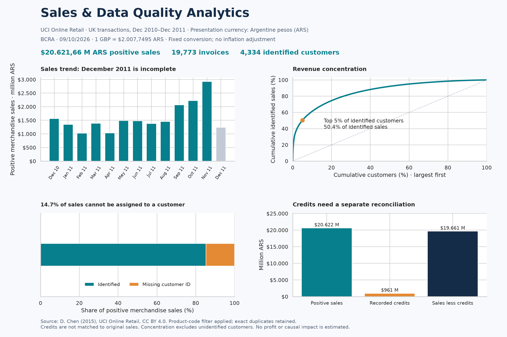

# ¿Cuánto podemos confiar en los indicadores de ventas?

Caso personal de análisis comercial con Python, pandas, NumPy y SQL. Datos históricos de un comercio online del Reino Unido. Período observado: 2010-12-01 08:26:00 a 2011-12-09 12:50:00. Moneda de presentación: pesos argentinos ($ ARS). Moneda original: GBP.

## Conversión documentada

Se aplica **1 GBP = $2.007,7495 ARS**, cotización publicada por el **BCRA para el 09/10/2026**, a todos los importes. Fórmula: `importe ARS = importe GBP × 2007.7495`. [Respuesta oficial del BCRA](https://api.bcra.gob.ar/estadisticascambiarias/v1.0/Cotizaciones?fecha=2026-10-09) y [copia conservada](sources/bcra_2026-10-09.json).

Se eligió una tasa fija de presentación cercana a la fecha de preparación del portfolio para facilitar la lectura en pesos. **No representa el tipo de cambio de las ventas de 2010–2011, una actualización por inflación ni ventas de un comercio argentino.** No incluye comisiones ni impuestos cambiarios. La fuente, la fecha y la huella SHA-256 quedan en `results/metrics.json`.

Los cálculos y las exportaciones conservan precisión antes del redondeo. El informe muestra dos decimales y los gráficos millones de ARS. Los valores GBP se conservan junto a los ARS; los porcentajes, rankings y conteos no cambian al aplicar la misma tasa positiva.

## Resultados

Se analizaron **541,909 líneas** del archivo original. Con la definición documentada de venta de mercadería se obtuvieron **$20.621.664.602,71 ARS en ventas positivas**, **19,773 facturas** y un importe medio de **$1.042.920,38 ARS por factura incluida**. Una factura puede contener varias líneas. Los totales incluyen únicamente las líneas que cumplen la definición.

1. **Concentración:** los 217 clientes que componen aproximadamente el 5% superior de los 4,334 clientes identificados acumulan el **50.4%** de las ventas identificadas. Propuesta: revisar continuidad de compra y necesidades de servicio de este grupo antes de diseñar una campaña. No demuestra abandono ni permite estimar su rentabilidad.
2. **Cobertura:** el **14.7%** de las ventas positivas no tiene identificador de cliente. Se conserva en los totales, pero se excluye del ranking. Propuesta: investigar cómo se captura ese dato antes de generalizar conclusiones de segmentación.
3. **Cancelaciones:** las líneas de mercadería con factura C, cantidad negativa y precio positivo suman **$961.158.233,03 ARS** en valor absoluto, equivalente al **4.7%** de las ventas positivas. Propuesta: conciliar estas notas con sus facturas de origen. El cociente no es una tasa de devolución de pedidos ni una pérdida de beneficios.

## Una decisión de limpieza que cambia el resultado

Hay **5,268 filas adicionales exactamente repetidas**. Se conservan en el escenario principal porque no existe un identificador único de línea que permita confirmar un error de carga. Quitarlas produciría ventas positivas por **$20.573.049.478,33 ARS**, una diferencia de **$48.615.124,38 ARS**. La comparación muestra sensibilidad a una regla, no un error confirmado del comercio.

## Método y límites

- Importe de línea = cantidad × precio unitario. Venta positiva = factura sin prefijo C, cantidad y precio positivos, fecha válida y código de producto con cinco dígitos seguidos de cero o más letras. Este filtro operativo separa cargos y códigos administrativos; puede excluir códigos atípicos de mercadería.
- Se conserva el archivo original. Las exclusiones se clasifican con prioridad explícita en `build_case.py` y se cuentan en `results/quality.csv`.
- SQL agrega primero las líneas por factura en GBP. Se verifican consistencia de fecha y cliente, conteo de facturas y totales independientes con pandas/NumPy. Luego se convierten a ARS. Importes analíticos en punto flotante; conciliación con tolerancia de 0,0001 GBP antes de convertir y $0,01 ARS en los totales convertidos.
- No se eliminan grandes compras como atípicos por su tamaño. El comercio incluye compradores mayoristas.
- Diciembre de 2011 termina el día 9; no se compara su total con meses completos para concluir una caída. Un único ciclo anual no prueba estacionalidad recurrente.
- Este caso no evalúa pronósticos: no alcanza los 24 meses requeridos por la app. La función de pronóstico de la aplicación es una capacidad separada.
- No hay costos, margen, inversión publicitaria ni experimento. No se estiman rentabilidad, ROI ni mejoras comerciales realizadas.

## Fuente

[Chen, D. (2015). Online Retail. UCI Machine Learning Repository](https://doi.org/10.24432/C5BW33). Licencia [CC BY 4.0](https://creativecommons.org/licenses/by/4.0/). Los resultados son una transformación analítica propia del dataset histórico, no una auditoría del negocio actual.
